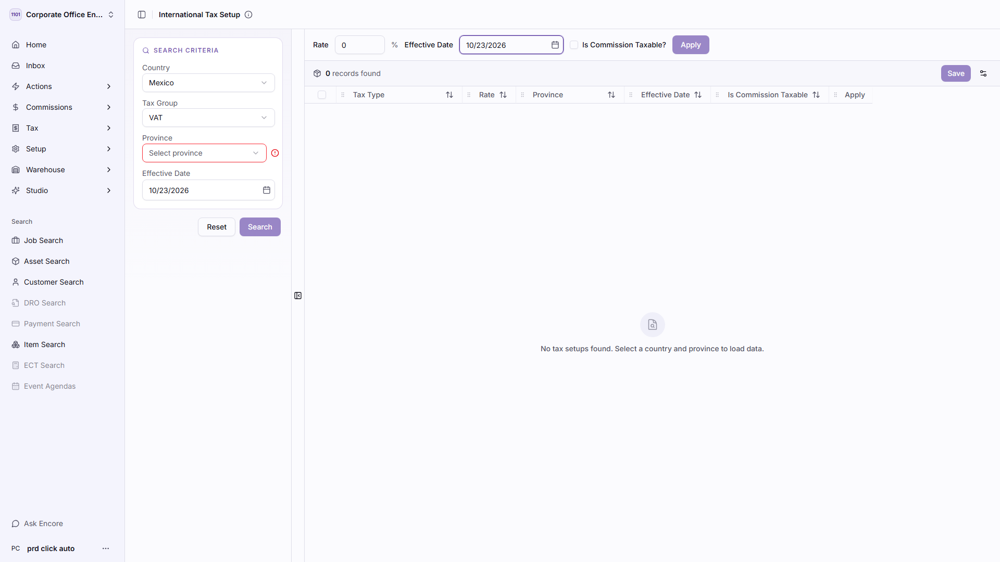
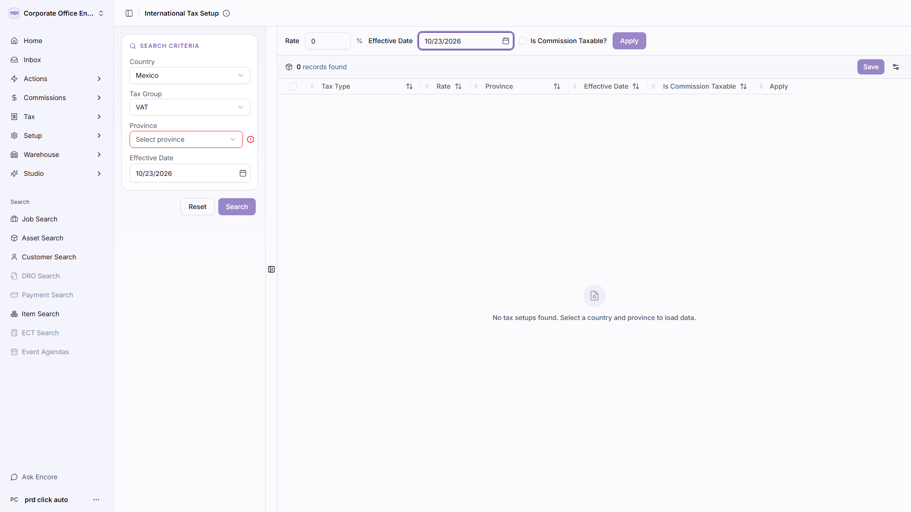

# Exploratory Crawl — Bug Report

**Application:** https://cloudapps-e2e.encoreglobal.com/navigator/locations/1101/taxes/international-tax-setup
**Run:** 2026-10-23T11:59:50.449Z → 2026-10-23T12:00:29.063Z (39s)
**Stopped because:** completed — frontier exhausted

| | |
| --- | --- |
| Pages visited | 1 |
| Actions performed | 12 |
| Scenarios explored | 6 |
| **Bugs found** | **5** |
| Raw findings before dedup | 5 |
| Crawl errors | 0 |
| Pages/actions not tested | 8 |

## Severity

| Severity | Count |
| --- | --- |
| Critical | 0 |
| Major | 0 |
| Minor | 5 |
| Trivial | 0 |

## Category

| Category | Count |
| --- | --- |
| Validation | 2 |
| UI | 2 |
| Accessibility | 1 |

## Bugs

| ID | Severity | Priority | Module | Title | Seen |
| --- | --- | --- | --- | --- | --- |
| BUG-INPUT-001 | Minor | P3 | International Tax Setup | Field "Rate" silently truncates input | 1x |
| BUG-INPUT-002 | Minor | P3 | International Tax Setup | Field "Select date" silently truncates input | 1x |
| BUG-LABEL-001 | Minor | P3 | International Tax Setup | 6 form control(s) have no accessible label on International Tax Setup | 1x |
| BUG-LAYOUT-001 | Minor | P3 | International Tax Setup | Text is cut off by its container on International Tax Setup | 1x |
| BUG-LAYOUT-002 | Minor | P3 | International Tax Setup | Interactive elements overlap on International Tax Setup | 1x |

### BUG-INPUT-001 — Field "Rate" silently truncates input

| Field | Value |
| --- | --- |
| **Severity** | Minor |
| **Priority** | P3 |
| **Category** | Validation |
| **Module / Page** | International Tax Setup |
| **URL** | https://cloudapps-e2e.encoreglobal.com/navigator/locations/1101/taxes/international-tax-setup |
| **Detector** | `input-boundary` |
| **Occurrences** | 1 |

**Preconditions**

- Signed in to the application with the automation account.
- Application reachable at https://cloudapps-e2e.encoreglobal.com.
- Screen under test: International Tax Setup.

**Steps to reproduce**

1. Open https://cloudapps-e2e.encoreglobal.com/navigator/locations/1101/taxes/international-tax-setup
2. Type 300 characters into the "Rate" field.
3. Observe that only 1 characters are kept and nothing explains why.

**Expected result:** A field that limits length declares it (maxlength, a counter, or a validation message) so the user knows the value was cut.

**Actual result:** 300 characters were entered and the field kept 1, with no maxlength attribute and no message.

**Evidence:** 

**Selector:** `#international-tax-setup-rate-apply`

---

### BUG-INPUT-002 — Field "Select date" silently truncates input

| Field | Value |
| --- | --- |
| **Severity** | Minor |
| **Priority** | P3 |
| **Category** | Validation |
| **Module / Page** | International Tax Setup |
| **URL** | https://cloudapps-e2e.encoreglobal.com/navigator/locations/1101/taxes/international-tax-setup |
| **Detector** | `input-boundary` |
| **Occurrences** | 1 |

**Preconditions**

- Signed in to the application with the automation account.
- Application reachable at https://cloudapps-e2e.encoreglobal.com.
- Screen under test: International Tax Setup.

**Steps to reproduce**

1. Open https://cloudapps-e2e.encoreglobal.com/navigator/locations/1101/taxes/international-tax-setup
2. Type 300 characters into the "Select date" field.
3. Observe that only 0 characters are kept and nothing explains why.

**Expected result:** A field that limits length declares it (maxlength, a counter, or a validation message) so the user knows the value was cut.

**Actual result:** 300 characters were entered and the field kept 0, with no maxlength attribute and no message.

**Evidence:** 

**Selector:** `div:nth-of-type(1) > div > div > input`

---

### BUG-LABEL-001 — 6 form control(s) have no accessible label on International Tax Setup

| Field | Value |
| --- | --- |
| **Severity** | Minor |
| **Priority** | P3 |
| **Category** | Accessibility |
| **Module / Page** | International Tax Setup |
| **URL** | https://cloudapps-e2e.encoreglobal.com/navigator/locations/1101/taxes/international-tax-setup |
| **Detector** | `missing-label` |
| **Occurrences** | 1 |

**Preconditions**

- Signed in to the application with the automation account.
- Application reachable at https://cloudapps-e2e.encoreglobal.com.
- Screen under test: International Tax Setup.

**Steps to reproduce**

1. Open https://cloudapps-e2e.encoreglobal.com/navigator/locations/1101/taxes/international-tax-setup
2. Inspect the form controls listed above and confirm none carries a label association.

**Expected result:** Every form control is named by a <label for>, aria-label or aria-labelledby, so assistive technology can announce it.

**Actual result:** 6 control(s) are named only by placeholder text or by nothing at all: button[type=button] (Mexico); select (Mexico Canada Bahamas); button[type=button] (VAT); select (VAT); button[type=button] (Select province)

**Evidence:** 

**Selector:** `#international-tax-setup-country`

---

### BUG-LAYOUT-001 — Text is cut off by its container on International Tax Setup

| Field | Value |
| --- | --- |
| **Severity** | Minor |
| **Priority** | P3 |
| **Category** | UI |
| **Module / Page** | International Tax Setup |
| **URL** | https://cloudapps-e2e.encoreglobal.com/navigator/locations/1101/taxes/international-tax-setup |
| **Detector** | `layout` |
| **Occurrences** | 1 |

**Preconditions**

- Signed in to the application with the automation account.
- Application reachable at https://cloudapps-e2e.encoreglobal.com.
- Screen under test: International Tax Setup.

**Steps to reproduce**

1. Open https://cloudapps-e2e.encoreglobal.com/navigator/locations/1101/taxes/international-tax-setup

**Expected result:** Text either fits, wraps, or is truncated deliberately with an ellipsis and a full value on hover.

**Actual result:** 1 element(s) hide overflowing text with no ellipsis: span: "Grid Options"

**Evidence:** 

---

### BUG-LAYOUT-002 — Interactive elements overlap on International Tax Setup

| Field | Value |
| --- | --- |
| **Severity** | Minor |
| **Priority** | P3 |
| **Category** | UI |
| **Module / Page** | International Tax Setup |
| **URL** | https://cloudapps-e2e.encoreglobal.com/navigator/locations/1101/taxes/international-tax-setup |
| **Detector** | `layout` |
| **Occurrences** | 1 |

**Preconditions**

- Signed in to the application with the automation account.
- Application reachable at https://cloudapps-e2e.encoreglobal.com.
- Screen under test: International Tax Setup.

**Steps to reproduce**

1. Open https://cloudapps-e2e.encoreglobal.com/navigator/locations/1101/taxes/international-tax-setup

**Expected result:** Controls do not sit on top of one another — an overlapped control cannot be clicked reliably.

**Actual result:** 2 overlapping pair(s). Worst: input "Select date" over button "Open calendar" (100% covered).

**Evidence:** 

---

## Coverage

### Pages visited

| # | Module | URL | Depth | Elements | Actions | Bugs | Reached via |
| --- | --- | --- | --- | --- | --- | --- | --- |
| 1 | International Tax Setup | https://cloudapps-e2e.encoreglobal.com/navigator/locations/1101/taxes/international-tax-setup | 0 | 54 | 12 | 5 | start URL |

### Scenarios explored

| Scenario | Outcome | Detail |
| --- | --- | --- |
| Open dialog from 1101 Corporate Office Encore USA SGA | explored | Dialog opened, inspected and dismissed with Escape. |
| Open dialog from Actions | explored | Dialog opened, inspected and dismissed with Escape. |
| Exercise select: VAT | explored | The screen re-rendered in response. |
| Open dialog from Commissions | explored | Dialog opened, inspected and dismissed with Escape. |
| Open dialog from Tax | explored | Dialog opened, inspected and dismissed with Escape. |
| Open dialog from Setup | explored | Dialog opened, inspected and dismissed with Escape. |

### Not tested

These were discovered but deliberately or unavoidably left alone. Anything here is a gap in
the crawl, not a clean bill of health.

| Target | Reason |
| --- | --- |
| https://cloudapps-e2e.encoreglobal.com/navigator/locations/1101/home | does not match any include pattern |
| https://cloudapps-e2e.encoreglobal.com/navigator/locations/1101/inbox | does not match any include pattern |
| https://cloudapps-e2e.encoreglobal.com/navigator/locations/1101/fulfillments | does not match any include pattern |
| https://cloudapps-e2e.encoreglobal.com/navigator/locations/1101/assets | does not match any include pattern |
| https://cloudapps-e2e.encoreglobal.com/navigator/locations/1101/customers | does not match any include pattern |
| https://cloudapps-e2e.encoreglobal.com/navigator/locations/1101/products | does not match any include pattern |
| https://cloudapps-e2e.encoreglobal.com/navigator/locations/1101/taxes/international-tax-setup :: Open the "Mexico Canada Bahamas" dropdown. | not interactable: covered by <button.cursor-pointer> |
| https://cloudapps-e2e.encoreglobal.com/navigator/locations/1101/taxes/international-tax-setup :: Open the "Aguascalientes Baja California Campeche Chiapas Baja Califo…" dropdown. | not interactable: covered by <button.cursor-pointer> |

## What was checked

| Detector | Looks for |
| --- | --- |
| `page-crash` | The screen rendered a crash banner, a stack trace, or nothing at all. |
| `console-error` | The page logged an uncaught error or a console error while it was being used. |
| `network-failure` | A request the screen made failed, or answered 4xx/5xx. |
| `broken-link` | Links that point nowhere, and links whose destination answers 4xx/5xx. |
| `dead-control` | A control that neither navigates, opens anything, nor changes the page. |
| `unexpected-route` | Navigation that lands somewhere other than where the control advertised. |
| `form-validation` | Fields that accept a value their own type says is invalid, without telling the user. |
| `input-boundary` | Boundary values that make the screen throw, hang, or silently mangle the input. |
| `placeholder-text` | Unresolved values, i18n keys or template fragments rendered as user-visible text. |
| `missing-label` | Form controls a screen reader cannot announce, because nothing names them. |
| `accessibility` | Unnamed controls, missing image alternatives, absent headings, duplicate ids. |
| `layout` | Horizontal overflow, text clipped by its container, and controls that overlap. |
| `page-title` | The browser tab names the screen. |

## Configuration used

```json
{
  "startUrl": "https://cloudapps-e2e.encoreglobal.com/navigator/locations/1101/taxes/international-tax-setup",
  "allowedOrigins": [
    "https://cloudapps-e2e.encoreglobal.com"
  ],
  "excludeUrlPatterns": [
    "logout",
    "signout",
    "sign-out",
    "\\/api\\/auth\\/signout",
    "login\\.microsoftonline\\.com",
    "b2clogin\\.com",
    "\\.(pdf|csv|xlsx|xls|zip|docx|png|jpe?g|gif|svg|woff2?|ttf)(\\?|$)",
    "^mailto:",
    "^tel:",
    "^javascript:",
    "\\/api\\/",
    "\\/_next\\/",
    "\\/auth\\/signin",
    "\\/reports\\/download"
  ],
  "includeUrlPatterns": [
    "international-tax-setup"
  ],
  "auth": {
    "mode": "storage-state",
    "signedInSelector": "h1"
  },
  "limits": {
    "maxPages": 25,
    "maxActionsPerPage": 12,
    "maxTotalActions": 200,
    "maxDepth": 1,
    "maxDurationMs": 600000,
    "settleMs": 900,
    "actionTimeoutMs": 8000,
    "navigationTimeoutMs": 30000
  },
  "safety": {
    "allowWrites": false,
    "allowDestructive": false
  },
  "enabledDetectors": [
    "page-crash",
    "console-error",
    "network-failure",
    "broken-link",
    "dead-control",
    "unexpected-route",
    "form-validation",
    "input-boundary",
    "placeholder-text",
    "missing-label",
    "accessibility",
    "layout",
    "page-title"
  ],
  "captureScreenshots": true,
  "outputDir": "reports/bugs/crawler/international-tax-setup"
}
```

