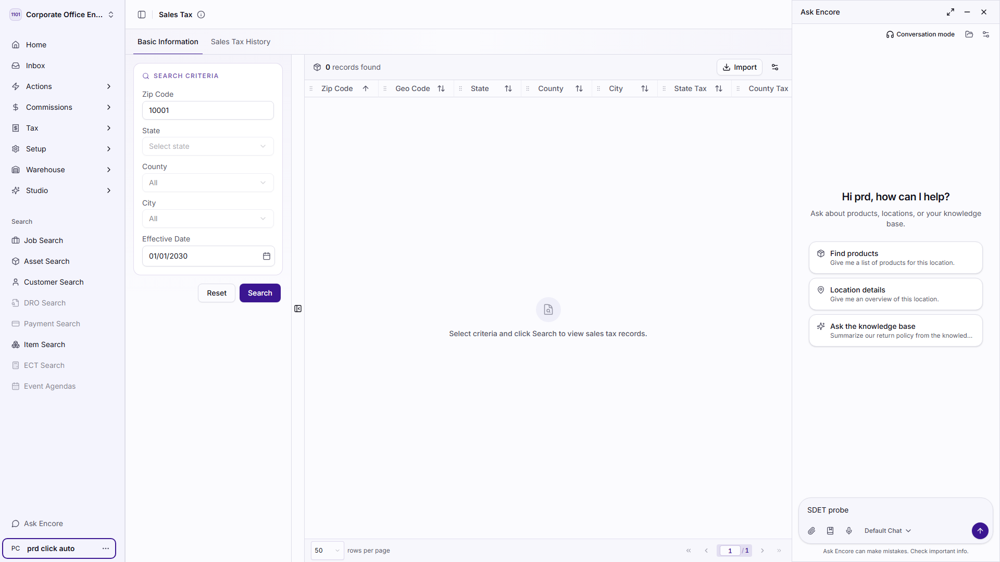
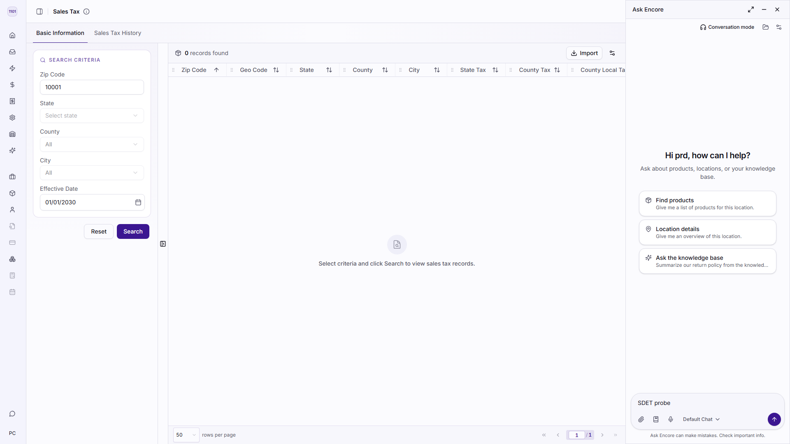
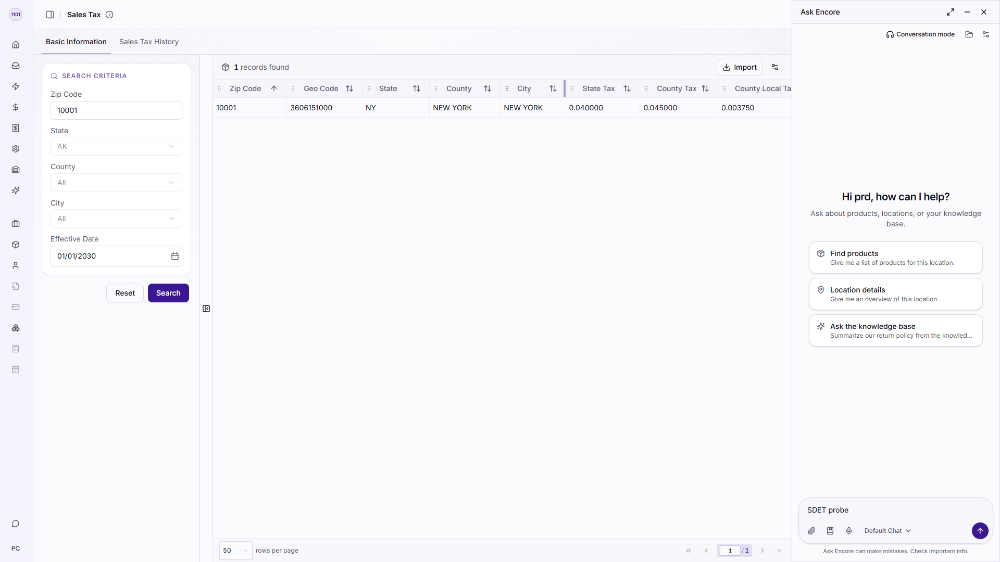
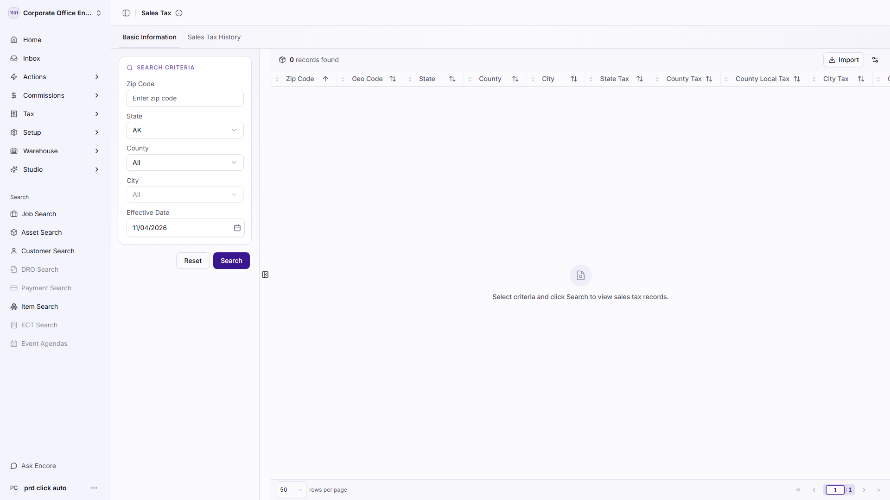

# Exploratory Crawl — Bug Report

**Application:** https://cloudapps-e2e.encoreglobal.com/navigator/locations/1101/taxes/sales-tax
**Run:** 2026-11-04T15:55:59.550Z → 2026-11-04T15:57:43.866Z (104s)
**Stopped because:** completed — frontier exhausted

| | |
| --- | --- |
| Pages visited | 1 |
| Actions performed | 53 |
| Scenarios explored | 36 |
| **Bugs found** | **16** |
| Raw findings before dedup | 23 |
| Crawl errors | 0 |
| Pages/actions not tested | 22 |

## Severity

| Severity | Count |
| --- | --- |
| Critical | 0 |
| Major | 12 |
| Minor | 4 |
| Trivial | 0 |

## Category

| Category | Count |
| --- | --- |
| Functional | 12 |
| UI | 2 |
| Validation | 1 |
| Accessibility | 1 |

## Bugs

| ID | Severity | Priority | Module | Title | Seen |
| --- | --- | --- | --- | --- | --- |
| BUG-CTRL-001 | Major | P2 | Sales Tax | "Click to restore sidebar" does nothing when clicked | 1x |
| BUG-CTRL-002 | Major | P2 | Sales Tax | "More information" does nothing when clicked | 1x |
| BUG-CTRL-003 | Major | P2 | Sales Tax | "Resize column zipCode" does nothing when clicked | 1x |
| BUG-CTRL-004 | Major | P2 | Sales Tax | "Resize column geoCode" does nothing when clicked | 1x |
| BUG-CTRL-005 | Major | P2 | Sales Tax | "Resize column stateName" does nothing when clicked | 1x |
| BUG-CTRL-006 | Major | P2 | Sales Tax | "Resize column countyName" does nothing when clicked | 1x |
| BUG-CTRL-007 | Major | P2 | Sales Tax | "Resize column cityName" does nothing when clicked | 1x |
| BUG-CTRL-008 | Major | P2 | Sales Tax | "Resize column stateTax" does nothing when clicked | 1x |
| BUG-CTRL-009 | Major | P2 | Sales Tax | "Resize column countyTax" does nothing when clicked | 1x |
| BUG-CTRL-010 | Major | P2 | Sales Tax | "Resize column cityTax" does nothing when clicked | 1x |
| BUG-CTRL-011 | Major | P2 | Sales Tax | "Resize column cityLocalTax" does nothing when clicked | 1x |
| BUG-CTRL-012 | Major | P2 | Sales Tax | "Resize column combinedTax" does nothing when clicked | 1x |
| BUG-INPUT-001 | Minor | P3 | Sales Tax | Field "Current page number" silently truncates input | 3x |
| BUG-LABEL-001 | Minor | P3 | Sales Tax | 8 form control(s) have no accessible label on Sales Tax | 3x |
| BUG-LAYOUT-001 | Minor | P3 | Sales Tax | Text is cut off by its container on Sales Tax | 3x |
| BUG-LAYOUT-002 | Minor | P3 | Sales Tax | Interactive elements overlap on Sales Tax | 2x |

### BUG-CTRL-001 — "Click to restore sidebar" does nothing when clicked

| Field | Value |
| --- | --- |
| **Severity** | Major |
| **Priority** | P2 |
| **Category** | Functional |
| **Module / Page** | Sales Tax |
| **URL** | https://cloudapps-e2e.encoreglobal.com/navigator/locations/1101/taxes/sales-tax |
| **Detector** | `dead-control` |
| **Occurrences** | 1 |

**Preconditions**

- Signed in to the application with the automation account.
- Application reachable at https://cloudapps-e2e.encoreglobal.com.
- Crawler ran with writes ENABLED (safety.allowWrites = true).
- Screen under test: Sales Tax.

**Steps to reproduce**

1. Open https://cloudapps-e2e.encoreglobal.com/navigator/locations/1101/taxes/sales-tax
2. Click "Click to restore sidebar".
3. Observe that nothing on the page changes.

**Expected result:** Clicking the button navigates, opens something, or changes what is on screen.

**Actual result:** After the click the URL is unchanged, no dialog opened, and the page content is byte-identical — the control has no visible effect.

**Evidence:** 

**Selector:** `div:nth-of-type(1) > div:nth-of-type(2) > div > button`

---

### BUG-CTRL-002 — "More information" does nothing when clicked

| Field | Value |
| --- | --- |
| **Severity** | Major |
| **Priority** | P2 |
| **Category** | Functional |
| **Module / Page** | Sales Tax |
| **URL** | https://cloudapps-e2e.encoreglobal.com/navigator/locations/1101/taxes/sales-tax |
| **Detector** | `dead-control` |
| **Occurrences** | 1 |

**Preconditions**

- Signed in to the application with the automation account.
- Application reachable at https://cloudapps-e2e.encoreglobal.com.
- Crawler ran with writes ENABLED (safety.allowWrites = true).
- Screen under test: Sales Tax.

**Steps to reproduce**

1. Open https://cloudapps-e2e.encoreglobal.com/navigator/locations/1101/taxes/sales-tax
2. Click "More information".
3. Observe that nothing on the page changes.

**Expected result:** Clicking the button navigates, opens something, or changes what is on screen.

**Actual result:** After the click the URL is unchanged, no dialog opened, and the page content is byte-identical — the control has no visible effect.

**Evidence:** 

**Selector:** `div > div:nth-of-type(2) > div > button`

---

### BUG-CTRL-003 — "Resize column zipCode" does nothing when clicked

| Field | Value |
| --- | --- |
| **Severity** | Major |
| **Priority** | P2 |
| **Category** | Functional |
| **Module / Page** | Sales Tax |
| **URL** | https://cloudapps-e2e.encoreglobal.com/navigator/locations/1101/taxes/sales-tax |
| **Detector** | `dead-control` |
| **Occurrences** | 1 |

**Preconditions**

- Signed in to the application with the automation account.
- Application reachable at https://cloudapps-e2e.encoreglobal.com.
- Crawler ran with writes ENABLED (safety.allowWrites = true).
- Screen under test: Sales Tax.

**Steps to reproduce**

1. Open https://cloudapps-e2e.encoreglobal.com/navigator/locations/1101/taxes/sales-tax
2. Click "Resize column zipCode".
3. Observe that nothing on the page changes.

**Expected result:** Clicking the button navigates, opens something, or changes what is on screen.

**Actual result:** After the click the URL is unchanged, no dialog opened, and the page content is byte-identical — the control has no visible effect.

**Evidence:** 

**Selector:** `thead > tr > th:nth-of-type(1) > button`

---

### BUG-CTRL-004 — "Resize column geoCode" does nothing when clicked

| Field | Value |
| --- | --- |
| **Severity** | Major |
| **Priority** | P2 |
| **Category** | Functional |
| **Module / Page** | Sales Tax |
| **URL** | https://cloudapps-e2e.encoreglobal.com/navigator/locations/1101/taxes/sales-tax |
| **Detector** | `dead-control` |
| **Occurrences** | 1 |

**Preconditions**

- Signed in to the application with the automation account.
- Application reachable at https://cloudapps-e2e.encoreglobal.com.
- Crawler ran with writes ENABLED (safety.allowWrites = true).
- Screen under test: Sales Tax.

**Steps to reproduce**

1. Open https://cloudapps-e2e.encoreglobal.com/navigator/locations/1101/taxes/sales-tax
2. Click "Resize column geoCode".
3. Observe that nothing on the page changes.

**Expected result:** Clicking the button navigates, opens something, or changes what is on screen.

**Actual result:** After the click the URL is unchanged, no dialog opened, and the page content is byte-identical — the control has no visible effect.

**Evidence:** 

**Selector:** `thead > tr > th:nth-of-type(2) > button`

---

### BUG-CTRL-005 — "Resize column stateName" does nothing when clicked

| Field | Value |
| --- | --- |
| **Severity** | Major |
| **Priority** | P2 |
| **Category** | Functional |
| **Module / Page** | Sales Tax |
| **URL** | https://cloudapps-e2e.encoreglobal.com/navigator/locations/1101/taxes/sales-tax |
| **Detector** | `dead-control` |
| **Occurrences** | 1 |

**Preconditions**

- Signed in to the application with the automation account.
- Application reachable at https://cloudapps-e2e.encoreglobal.com.
- Crawler ran with writes ENABLED (safety.allowWrites = true).
- Screen under test: Sales Tax.

**Steps to reproduce**

1. Open https://cloudapps-e2e.encoreglobal.com/navigator/locations/1101/taxes/sales-tax
2. Click "Resize column stateName".
3. Observe that nothing on the page changes.

**Expected result:** Clicking the button navigates, opens something, or changes what is on screen.

**Actual result:** After the click the URL is unchanged, no dialog opened, and the page content is byte-identical — the control has no visible effect.

**Evidence:** 

**Selector:** `thead > tr > th:nth-of-type(3) > button`

---

### BUG-CTRL-006 — "Resize column countyName" does nothing when clicked

| Field | Value |
| --- | --- |
| **Severity** | Major |
| **Priority** | P2 |
| **Category** | Functional |
| **Module / Page** | Sales Tax |
| **URL** | https://cloudapps-e2e.encoreglobal.com/navigator/locations/1101/taxes/sales-tax |
| **Detector** | `dead-control` |
| **Occurrences** | 1 |

**Preconditions**

- Signed in to the application with the automation account.
- Application reachable at https://cloudapps-e2e.encoreglobal.com.
- Crawler ran with writes ENABLED (safety.allowWrites = true).
- Screen under test: Sales Tax.

**Steps to reproduce**

1. Open https://cloudapps-e2e.encoreglobal.com/navigator/locations/1101/taxes/sales-tax
2. Click "Resize column countyName".
3. Observe that nothing on the page changes.

**Expected result:** Clicking the button navigates, opens something, or changes what is on screen.

**Actual result:** After the click the URL is unchanged, no dialog opened, and the page content is byte-identical — the control has no visible effect.

**Evidence:** 

**Selector:** `thead > tr > th:nth-of-type(4) > button`

---

### BUG-CTRL-007 — "Resize column cityName" does nothing when clicked

| Field | Value |
| --- | --- |
| **Severity** | Major |
| **Priority** | P2 |
| **Category** | Functional |
| **Module / Page** | Sales Tax |
| **URL** | https://cloudapps-e2e.encoreglobal.com/navigator/locations/1101/taxes/sales-tax |
| **Detector** | `dead-control` |
| **Occurrences** | 1 |

**Preconditions**

- Signed in to the application with the automation account.
- Application reachable at https://cloudapps-e2e.encoreglobal.com.
- Crawler ran with writes ENABLED (safety.allowWrites = true).
- Screen under test: Sales Tax.

**Steps to reproduce**

1. Open https://cloudapps-e2e.encoreglobal.com/navigator/locations/1101/taxes/sales-tax
2. Click "Resize column cityName".
3. Observe that nothing on the page changes.

**Expected result:** Clicking the button navigates, opens something, or changes what is on screen.

**Actual result:** After the click the URL is unchanged, no dialog opened, and the page content is byte-identical — the control has no visible effect.

**Evidence:** 

**Selector:** `thead > tr > th:nth-of-type(5) > button`

---

### BUG-CTRL-008 — "Resize column stateTax" does nothing when clicked

| Field | Value |
| --- | --- |
| **Severity** | Major |
| **Priority** | P2 |
| **Category** | Functional |
| **Module / Page** | Sales Tax |
| **URL** | https://cloudapps-e2e.encoreglobal.com/navigator/locations/1101/taxes/sales-tax |
| **Detector** | `dead-control` |
| **Occurrences** | 1 |

**Preconditions**

- Signed in to the application with the automation account.
- Application reachable at https://cloudapps-e2e.encoreglobal.com.
- Crawler ran with writes ENABLED (safety.allowWrites = true).
- Screen under test: Sales Tax.

**Steps to reproduce**

1. Open https://cloudapps-e2e.encoreglobal.com/navigator/locations/1101/taxes/sales-tax
2. Click "Resize column stateTax".
3. Observe that nothing on the page changes.

**Expected result:** Clicking the button navigates, opens something, or changes what is on screen.

**Actual result:** After the click the URL is unchanged, no dialog opened, and the page content is byte-identical — the control has no visible effect.

**Evidence:** 

**Selector:** `thead > tr > th:nth-of-type(6) > button`

---

### BUG-CTRL-009 — "Resize column countyTax" does nothing when clicked

| Field | Value |
| --- | --- |
| **Severity** | Major |
| **Priority** | P2 |
| **Category** | Functional |
| **Module / Page** | Sales Tax |
| **URL** | https://cloudapps-e2e.encoreglobal.com/navigator/locations/1101/taxes/sales-tax |
| **Detector** | `dead-control` |
| **Occurrences** | 1 |

**Preconditions**

- Signed in to the application with the automation account.
- Application reachable at https://cloudapps-e2e.encoreglobal.com.
- Crawler ran with writes ENABLED (safety.allowWrites = true).
- Screen under test: Sales Tax.

**Steps to reproduce**

1. Open https://cloudapps-e2e.encoreglobal.com/navigator/locations/1101/taxes/sales-tax
2. Click "Resize column countyTax".
3. Observe that nothing on the page changes.

**Expected result:** Clicking the button navigates, opens something, or changes what is on screen.

**Actual result:** After the click the URL is unchanged, no dialog opened, and the page content is byte-identical — the control has no visible effect.

**Evidence:** 

**Selector:** `thead > tr > th:nth-of-type(7) > button`

---

### BUG-CTRL-010 — "Resize column cityTax" does nothing when clicked

| Field | Value |
| --- | --- |
| **Severity** | Major |
| **Priority** | P2 |
| **Category** | Functional |
| **Module / Page** | Sales Tax |
| **URL** | https://cloudapps-e2e.encoreglobal.com/navigator/locations/1101/taxes/sales-tax |
| **Detector** | `dead-control` |
| **Occurrences** | 1 |

**Preconditions**

- Signed in to the application with the automation account.
- Application reachable at https://cloudapps-e2e.encoreglobal.com.
- Crawler ran with writes ENABLED (safety.allowWrites = true).
- Screen under test: Sales Tax.

**Steps to reproduce**

1. Open https://cloudapps-e2e.encoreglobal.com/navigator/locations/1101/taxes/sales-tax
2. Click "Resize column cityTax".
3. Observe that nothing on the page changes.

**Expected result:** Clicking the button navigates, opens something, or changes what is on screen.

**Actual result:** After the click the URL is unchanged, no dialog opened, and the page content is byte-identical — the control has no visible effect.

**Evidence:** 

**Selector:** `thead > tr > th:nth-of-type(9) > button`

---

### BUG-CTRL-011 — "Resize column cityLocalTax" does nothing when clicked

| Field | Value |
| --- | --- |
| **Severity** | Major |
| **Priority** | P2 |
| **Category** | Functional |
| **Module / Page** | Sales Tax |
| **URL** | https://cloudapps-e2e.encoreglobal.com/navigator/locations/1101/taxes/sales-tax |
| **Detector** | `dead-control` |
| **Occurrences** | 1 |

**Preconditions**

- Signed in to the application with the automation account.
- Application reachable at https://cloudapps-e2e.encoreglobal.com.
- Crawler ran with writes ENABLED (safety.allowWrites = true).
- Screen under test: Sales Tax.

**Steps to reproduce**

1. Open https://cloudapps-e2e.encoreglobal.com/navigator/locations/1101/taxes/sales-tax
2. Click "Resize column cityLocalTax".
3. Observe that nothing on the page changes.

**Expected result:** Clicking the button navigates, opens something, or changes what is on screen.

**Actual result:** After the click the URL is unchanged, no dialog opened, and the page content is byte-identical — the control has no visible effect.

**Evidence:** 

**Selector:** `thead > tr > th:nth-of-type(10) > button`

---

### BUG-CTRL-012 — "Resize column combinedTax" does nothing when clicked

| Field | Value |
| --- | --- |
| **Severity** | Major |
| **Priority** | P2 |
| **Category** | Functional |
| **Module / Page** | Sales Tax |
| **URL** | https://cloudapps-e2e.encoreglobal.com/navigator/locations/1101/taxes/sales-tax |
| **Detector** | `dead-control` |
| **Occurrences** | 1 |

**Preconditions**

- Signed in to the application with the automation account.
- Application reachable at https://cloudapps-e2e.encoreglobal.com.
- Crawler ran with writes ENABLED (safety.allowWrites = true).
- Screen under test: Sales Tax.

**Steps to reproduce**

1. Open https://cloudapps-e2e.encoreglobal.com/navigator/locations/1101/taxes/sales-tax
2. Click "Resize column combinedTax".
3. Observe that nothing on the page changes.

**Expected result:** Clicking the button navigates, opens something, or changes what is on screen.

**Actual result:** After the click the URL is unchanged, no dialog opened, and the page content is byte-identical — the control has no visible effect.

**Evidence:** 

**Selector:** `thead > tr > th:nth-of-type(11) > button`

---

### BUG-INPUT-001 — Field "Current page number" silently truncates input

| Field | Value |
| --- | --- |
| **Severity** | Minor |
| **Priority** | P3 |
| **Category** | Validation |
| **Module / Page** | Sales Tax |
| **URL** | https://cloudapps-e2e.encoreglobal.com/navigator/locations/1101/taxes/sales-tax |
| **Detector** | `input-boundary` |
| **Occurrences** | 3 |

**Preconditions**

- Signed in to the application with the automation account.
- Application reachable at https://cloudapps-e2e.encoreglobal.com.
- Crawler ran with writes ENABLED (safety.allowWrites = true).
- Screen under test: Sales Tax.

**Steps to reproduce**

1. Open https://cloudapps-e2e.encoreglobal.com/navigator/locations/1101/taxes/sales-tax
2. Type 300 characters into the "Current page number" field.
3. Observe that only 1 characters are kept and nothing explains why.

**Expected result:** A field that limits length declares it (maxlength, a counter, or a validation message) so the user knows the value was cut.

**Actual result:** 300 characters were entered and the field kept 1, with no maxlength attribute and no message.

**Evidence:** 

**Selector:** `div > div:nth-of-type(2) > span > input`

**Also seen on**

- Sales Tax > Sales Tax History — https://cloudapps-e2e.encoreglobal.com/navigator/locations/1101/taxes/sales-tax
- Sales Tax > Basic Information — https://cloudapps-e2e.encoreglobal.com/navigator/locations/1101/taxes/sales-tax

---

### BUG-LABEL-001 — 8 form control(s) have no accessible label on Sales Tax

| Field | Value |
| --- | --- |
| **Severity** | Minor |
| **Priority** | P3 |
| **Category** | Accessibility |
| **Module / Page** | Sales Tax |
| **URL** | https://cloudapps-e2e.encoreglobal.com/navigator/locations/1101/taxes/sales-tax |
| **Detector** | `missing-label` |
| **Occurrences** | 3 |

**Preconditions**

- Signed in to the application with the automation account.
- Application reachable at https://cloudapps-e2e.encoreglobal.com.
- Crawler ran with writes ENABLED (safety.allowWrites = true).
- Screen under test: Sales Tax.

**Steps to reproduce**

1. Open https://cloudapps-e2e.encoreglobal.com/navigator/locations/1101/taxes/sales-tax
2. Inspect the form controls listed above and confirm none carries a label association.

**Expected result:** Every form control is named by a <label for>, aria-label or aria-labelledby, so assistive technology can announce it.

**Actual result:** 8 control(s) are named only by placeholder text or by nothing at all: input (Enter zip code); button[type=button] (AK); select (AK AL AR AS AZ CA CO CT DC DE FL FM GA GU HI IA I…); button[type=button] (All); select (All ALEUTIANS EAST ALEUTIANS WEST ANCHORAGE BETHE…)

**Evidence:** 

**Selector:** `#sales-tax-zip-code`

**Also seen on**

- Sales Tax > Sales Tax History — https://cloudapps-e2e.encoreglobal.com/navigator/locations/1101/taxes/sales-tax
- Sales Tax > Basic Information — https://cloudapps-e2e.encoreglobal.com/navigator/locations/1101/taxes/sales-tax

---

### BUG-LAYOUT-001 — Text is cut off by its container on Sales Tax

| Field | Value |
| --- | --- |
| **Severity** | Minor |
| **Priority** | P3 |
| **Category** | UI |
| **Module / Page** | Sales Tax |
| **URL** | https://cloudapps-e2e.encoreglobal.com/navigator/locations/1101/taxes/sales-tax |
| **Detector** | `layout` |
| **Occurrences** | 3 |

**Preconditions**

- Signed in to the application with the automation account.
- Application reachable at https://cloudapps-e2e.encoreglobal.com.
- Crawler ran with writes ENABLED (safety.allowWrites = true).
- Screen under test: Sales Tax.

**Steps to reproduce**

1. Open https://cloudapps-e2e.encoreglobal.com/navigator/locations/1101/taxes/sales-tax

**Expected result:** Text either fits, wraps, or is truncated deliberately with an ellipsis and a full value on hover.

**Actual result:** 1 element(s) hide overflowing text with no ellipsis: span: "Grid Options"

**Evidence:** 

**Also seen on**

- Sales Tax > Sales Tax History — https://cloudapps-e2e.encoreglobal.com/navigator/locations/1101/taxes/sales-tax
- Sales Tax > Basic Information — https://cloudapps-e2e.encoreglobal.com/navigator/locations/1101/taxes/sales-tax

---

### BUG-LAYOUT-002 — Interactive elements overlap on Sales Tax

| Field | Value |
| --- | --- |
| **Severity** | Minor |
| **Priority** | P3 |
| **Category** | UI |
| **Module / Page** | Sales Tax |
| **URL** | https://cloudapps-e2e.encoreglobal.com/navigator/locations/1101/taxes/sales-tax |
| **Detector** | `layout` |
| **Occurrences** | 2 |

**Preconditions**

- Signed in to the application with the automation account.
- Application reachable at https://cloudapps-e2e.encoreglobal.com.
- Crawler ran with writes ENABLED (safety.allowWrites = true).
- Screen under test: Sales Tax.

**Steps to reproduce**

1. Open https://cloudapps-e2e.encoreglobal.com/navigator/locations/1101/taxes/sales-tax

**Expected result:** Controls do not sit on top of one another — an overlapped control cannot be clicked reliably.

**Actual result:** 1 overlapping pair(s). Worst: input "Select date" over button "Open calendar" (100% covered).

**Evidence:** 

**Also seen on**

- Sales Tax > Basic Information — https://cloudapps-e2e.encoreglobal.com/navigator/locations/1101/taxes/sales-tax

---

## Coverage

### Pages visited

| # | Module | URL | Depth | Elements | Actions | Bugs | Reached via |
| --- | --- | --- | --- | --- | --- | --- | --- |
| 1 | Sales Tax | https://cloudapps-e2e.encoreglobal.com/navigator/locations/1101/taxes/sales-tax | 0 | 69 | 53 | 23 | start URL |

### Scenarios explored

| Scenario | Outcome | Detail |
| --- | --- | --- |
| Exercise tab: Sales Tax History | explored | The screen re-rendered in response. |
| Exercise tab: Basic Information | explored | The screen re-rendered in response. |
| Open dialog from 1101 Corporate Office Encore USA SGA | explored | Dialog opened, inspected and dismissed with Escape. |
| Open dialog from Actions | explored | Dialog opened, inspected and dismissed with Escape. |
| Exercise select: All | explored | The screen re-rendered in response. |
| Open dialog from Commissions | explored | Dialog opened, inspected and dismissed with Escape. |
| Exercise select: 50 | explored | The screen re-rendered in response. |
| Open dialog from Tax | explored | Dialog opened, inspected and dismissed with Escape. |
| Open dialog from Setup | explored | Dialog opened, inspected and dismissed with Escape. |
| Open dialog from Warehouse | explored | Dialog opened, inspected and dismissed with Escape. |
| Open dialog from Studio | explored | Dialog opened, inspected and dismissed with Escape. |
| Exercise input: Enter zip code | explored | The screen re-rendered in response. |
| Exercise button: Ask Encore | explored | The screen re-rendered in response. |
| Exercise textarea: input | explored | The screen re-rendered in response. |
| Open dialog from PC prd click auto | explored | Dialog opened, inspected and dismissed with Escape. |
| Exercise button: trigger-button | explored | The screen re-rendered in response. |
| Open dialog from Open calendar | explored | Dialog opened, inspected and dismissed with Escape. |
| Exercise button: Search | explored | The screen re-rendered in response. |
| Exercise button: Collapse filters | explored | The screen re-rendered in response. |
| Exercise button: Expand filters | explored | The screen re-rendered in response. |
| Open dialog from Grid Options | explored | Dialog opened, inspected and dismissed with Escape. |
| Open dialog from Zip Code | explored | Dialog opened, inspected and dismissed with Escape. |
| Open dialog from Geo Code | explored | Dialog opened, inspected and dismissed with Escape. |
| Open dialog from State | explored | Dialog opened, inspected and dismissed with Escape. |
| Open dialog from County | explored | Dialog opened, inspected and dismissed with Escape. |
| Open dialog from City | explored | Dialog opened, inspected and dismissed with Escape. |
| Open dialog from State Tax | explored | Dialog opened, inspected and dismissed with Escape. |
| Open dialog from County Tax | explored | Dialog opened, inspected and dismissed with Escape. |
| Open dialog from County Local Tax | explored | Dialog opened, inspected and dismissed with Escape. |
| Exercise button: Resize column countyLocalTax | explored | The screen re-rendered in response. |
| Open dialog from City Tax | explored | Dialog opened, inspected and dismissed with Escape. |
| Open dialog from City Local Tax | explored | Dialog opened, inspected and dismissed with Escape. |
| Open dialog from Combined Tax | explored | Dialog opened, inspected and dismissed with Escape. |
| Open dialog from Effective Date | explored | Dialog opened, inspected and dismissed with Escape. |
| Exercise button: Resize column effectiveDate | explored | The screen re-rendered in response. |
| Navigate via button: Full Screen | explored | Landed on https://cloudapps-e2e.encoreglobal.com/navigator/locations/1101/chat/00000000-0000-0000-0000-000000000000 |

### Not tested

These were discovered but deliberately or unavoidably left alone. Anything here is a gap in
the crawl, not a clean bill of health.

| Target | Reason |
| --- | --- |
| https://cloudapps-e2e.encoreglobal.com/navigator/locations/1101/home | does not match any include pattern |
| https://cloudapps-e2e.encoreglobal.com/navigator/locations/1101/inbox | does not match any include pattern |
| https://cloudapps-e2e.encoreglobal.com/navigator/locations/1101/fulfillments | does not match any include pattern |
| https://cloudapps-e2e.encoreglobal.com/navigator/locations/1101/assets | does not match any include pattern |
| https://cloudapps-e2e.encoreglobal.com/navigator/locations/1101/customers | does not match any include pattern |
| https://cloudapps-e2e.encoreglobal.com/navigator/locations/1101/products | does not match any include pattern |
| https://cloudapps-e2e.encoreglobal.com/navigator/locations/1101/taxes/sales-tax :: Open the "Basic Information" tab. | tab is already the selected one |
| https://cloudapps-e2e.encoreglobal.com/navigator/locations/1101/taxes/sales-tax :: Use the "Go to first page" pagination control. | control is disabled |
| https://cloudapps-e2e.encoreglobal.com/navigator/locations/1101/taxes/sales-tax :: Open the "AK AL AR AS AZ CA CO CT DC DE FL FM GA GU HI IA ID IL IN KS…" dropdown. | interaction failed: locator.click: Timeout 8000ms exceeded. Call log:  - waiting for locator('[data-sdet-ref="e27"]').first()  - locator resolved to <select tabindex="-1" aria-hidden="true" data-sdet-ref="e27">…</select>  - attempting click action  2 × waiting for element to be visible, … |
| https://cloudapps-e2e.encoreglobal.com/navigator/locations/1101/taxes/sales-tax :: Open the "All ALEUTIANS EAST ALEUTIANS WEST ANCHORAGE BETHEL BRISTOL …" dropdown. | interaction failed: locator.click: Timeout 8000ms exceeded. Call log:  - waiting for locator('[data-sdet-ref="e29"]').first()  - locator resolved to <select tabindex="-1" aria-hidden="true" data-sdet-ref="e29">…</select>  - attempting click action  2 × waiting for element to be visible, … |
| https://cloudapps-e2e.encoreglobal.com/navigator/locations/1101/taxes/sales-tax :: Click "DRO Search". | control is disabled |
| https://cloudapps-e2e.encoreglobal.com/navigator/locations/1101/taxes/sales-tax :: Open the "Select state" dropdown. | control is disabled |
| https://cloudapps-e2e.encoreglobal.com/navigator/locations/1101/taxes/sales-tax :: Use the "Go to previous page" pagination control. | control is disabled |
| https://cloudapps-e2e.encoreglobal.com/navigator/locations/1101/taxes/sales-tax :: Click "Payment Search". | control is disabled |
| https://cloudapps-e2e.encoreglobal.com/navigator/locations/1101/taxes/sales-tax :: Use the "Go to next page" pagination control. | control is disabled |
| https://cloudapps-e2e.encoreglobal.com/navigator/locations/1101/taxes/sales-tax :: Click "ECT Search". | control is disabled |
| https://cloudapps-e2e.encoreglobal.com/navigator/locations/1101/taxes/sales-tax :: Use the "Go to last page" pagination control. | control is disabled |
| https://cloudapps-e2e.encoreglobal.com/navigator/locations/1101/taxes/sales-tax :: Click "Event Agendas". | control is disabled |
| https://cloudapps-e2e.encoreglobal.com/navigator/locations/1101/taxes/sales-tax :: Click "Reset". | destructive action ("reset") — safety.allowDestructive is off |
| https://cloudapps-e2e.encoreglobal.com/navigator/locations/1101/taxes/sales-tax :: Click "Import". | never-click control ("import") |
| https://cloudapps-e2e.encoreglobal.com/navigator/locations/1101/chat/00000000-0000-0000-0000-000000000000 | does not match any include pattern |
| https://cloudapps-e2e.encoreglobal.com/navigator/locations/1101/taxes/sales-tax | remaining controls not exercised — "Full Screen" navigated away |

## What was checked

| Detector | Looks for |
| --- | --- |
| `page-crash` | The screen rendered a crash banner, a stack trace, or nothing at all. |
| `console-error` | The page logged an uncaught error or a console error while it was being used. |
| `network-failure` | A request the screen made failed, or answered 4xx/5xx. |
| `broken-link` | Links that point nowhere, and links whose destination answers 4xx/5xx. |
| `dead-control` | A control that neither navigates, opens anything, nor changes the page. |
| `unexpected-route` | Navigation that lands somewhere other than where the control advertised. |
| `form-validation` | Fields that accept a value their own type says is invalid, without telling the user. |
| `input-boundary` | Boundary values that make the screen throw, hang, or silently mangle the input. |
| `placeholder-text` | Unresolved values, i18n keys or template fragments rendered as user-visible text. |
| `missing-label` | Form controls a screen reader cannot announce, because nothing names them. |
| `accessibility` | Unnamed controls, missing image alternatives, absent headings, duplicate ids. |
| `layout` | Horizontal overflow, text clipped by its container, and controls that overlap. |
| `page-title` | The browser tab names the screen. |

## Configuration used

```json
{
  "startUrl": "https://cloudapps-e2e.encoreglobal.com/navigator/locations/1101/taxes/sales-tax",
  "allowedOrigins": [
    "https://cloudapps-e2e.encoreglobal.com"
  ],
  "excludeUrlPatterns": [
    "logout",
    "signout",
    "sign-out",
    "\\/api\\/auth\\/signout",
    "login\\.microsoftonline\\.com",
    "b2clogin\\.com",
    "\\.(pdf|csv|xlsx|xls|zip|docx|png|jpe?g|gif|svg|woff2?|ttf)(\\?|$)",
    "^mailto:",
    "^tel:",
    "^javascript:",
    "\\/api\\/",
    "\\/_next\\/",
    "\\/auth\\/signin",
    "\\/reports\\/download"
  ],
  "includeUrlPatterns": [
    "taxes\\/sales-tax"
  ],
  "auth": {
    "mode": "storage-state",
    "signedInSelector": "h1"
  },
  "limits": {
    "maxPages": 3,
    "maxActionsPerPage": 60,
    "maxTotalActions": 120,
    "maxDepth": 3,
    "maxDurationMs": 900000,
    "settleMs": 900,
    "actionTimeoutMs": 8000,
    "navigationTimeoutMs": 30000
  },
  "safety": {
    "allowWrites": true,
    "allowDestructive": false
  },
  "enabledDetectors": [
    "page-crash",
    "console-error",
    "network-failure",
    "broken-link",
    "dead-control",
    "unexpected-route",
    "form-validation",
    "input-boundary",
    "placeholder-text",
    "missing-label",
    "accessibility",
    "layout",
    "page-title"
  ],
  "captureScreenshots": true,
  "outputDir": "reports/bugs/crawler/sales-tax-search"
}
```

